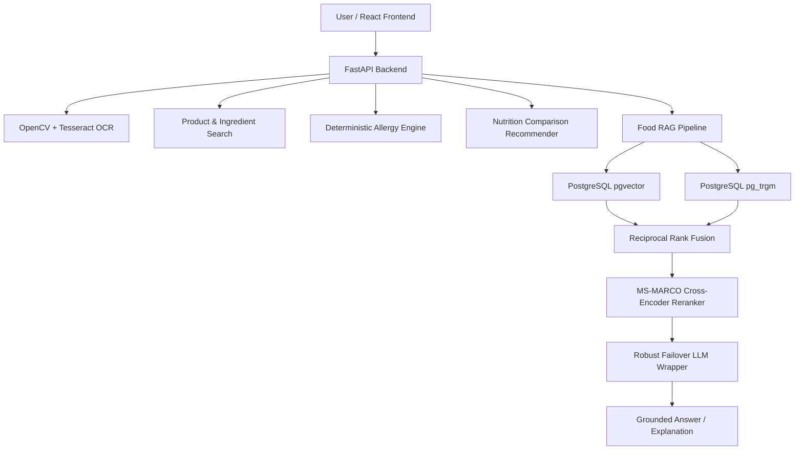

# 🥗 FoodIntellect MVP

An enterprise-grade, multi-modal Food Intelligence system combining **Label OCR**, **Deterministic Allergy Matching**, **Hybrid RAG Knowledge Retrieval**, and **Nutritional Recommendation Engines**.

---

## 🌟 Key Features

- **Hybrid Knowledge Retrieval**: Combines PostgreSQL `pgvector` 384-dimensional dense cosine search (`all-MiniLM-L6-v2`) with `pg_trgm` sparse trigram keyword matching using Reciprocal Rank Fusion (RRF).
- **Cross-Encoder Reranking**: Re-scores top retrieval candidates using `cross-encoder/ms-marco-MiniLM-L-12-v2` for precise context selection.
- **Robust LLM Failover Wrapper**: Multi-provider fallback (`google gemini-3.6-flash` $\rightarrow$ `groq llama-3.3-70b` $\rightarrow$ `openrouter`) guarantees high uptime during live demos.
- **Deterministic Safety Engine**: Rule-based allergy and dietary restriction matching ($A \cap B \neq \emptyset$) isolates safety critical logic from LLM hallucinations.
- **Computer Vision OCR**: OpenCV preprocessing (grayscale, binarization, noise reduction) + Tesseract OCR for food packaging text extraction.

---

## 🏗️ System Architecture



---

## 🛠️ Technology Stack

- **Backend**: Python 3.12+, FastAPI, Uvicorn
- **AI / RAG**: LangChain, LangGraph, SentenceTransformers, CrossEncoder, OpenAI API Client, Google Gemini
- **Database**: PostgreSQL 16, pgvector, pg_trgm
- **Computer Vision**: OpenCV (`cv2`), PyTesseract, RapidFuzz
- **Infrastructure**: Docker, Docker Compose
- **Testing & Evals**: Pytest, RAGAS

---

## 📁 Directory Structure

```text
.
├── data/
│   └── food_corpus/             # Structured Food & Ingredient Knowledge Base
├── docs/
│   ├── ARCHITECTURE_DECISIONS.md # ADR documents
│   └── PROGRESS_2026-09-01.md    # Daily progress logs
├── scripts/
│   ├── generate_seed_corpus.py  # Seed dataset generator
│   ├── reinit_db.py             # Database schema initialization
│   ├── ingest_food_corpus.py    # Vector embedding & ingestion pipeline
│   └── test_food_query.py       # Baseline RAG verification test suite
├── src/
│   ├── agents/                  # LangGraph orchestration
│   ├── api/                     # FastAPI application endpoints
│   ├── core/
│   │   ├── database/            # PostgreSQL pgvector & hybrid search engine
│   │   ├── llm.py               # Robust multi-provider failover wrapper
│   │   └── pipeline.py          # RAG embed & rerank pipeline
│   └── utils/
│       └── config.py            # Pydantic environment configuration
├── docker-compose.yml           # PostgreSQL + pgvector infrastructure (Port 5445)
├── requirements.txt
├── ROADMAP.md                   # 16-Phase MVP Roadmap
└── README.md
```

---

## ⚡ Quick Start & Installation

### 1. Prerequisites
- Python 3.10+
- Docker & Docker Compose
- PostgreSQL with `pgvector`

### 2. Environment Setup
Clone or navigate into `FoodIntellect` and install dependencies:
```bash
python -m venv venv
source venv/bin/activate  # On Windows: venv\Scripts\activate
pip install -r requirements.txt
```

Set up your `.env` file with API keys:
```env
GEMINI_API_KEY=AIzaSy...
GROQ_API_KEY=gsk_...
OPENROUTER_API_KEY=sk-or-v1-...

DB_HOST=localhost
DB_PORT=5445
DB_NAME=rag_bootcamp
DB_USER=rag_app_user
DB_PASSWORD=rag_password
```

### 3. Start Database Infrastructure
```bash
docker-compose up -d db
```

### 4. Initialize Schema & Ingest Food Data
```bash
# Initialize DB tables and vector indices
python scripts/reinit_db.py

# Ingest 25 food knowledge base documents
python scripts/ingest_food_corpus.py
```

### 5. Run Verification Tests
```bash
python scripts/test_food_query.py
```

---

## 📊 Verification Output Example

```text
===============================================================
       FOODINTELLECT MVP: RAG BASELINE VERIFICATION TEST       
===============================================================

---------------------------------------------------------------
 ❓ Question 1: What is lecithin and why is it used in food?
---------------------------------------------------------------
[INFO] Successfully used LLM provider: google
🤖 LLM Provider Used : google
📦 Chunks Retrieved : 3
💡 LLM Answer       :
Lecithin is a natural fatty substance (emulsifier/phospholipid) extracted 
from soybeans or egg yolks. It functions as an emulsifier to blend oil 
and water smoothly in chocolate, margarine, and baked goods.

===============================================================
 [SUCCESS] All 5 Food RAG Verification Queries Completed!
===============================================================
```

---

## 📄 License
Academic Final-Year Project. Developed by Team FoodIntellect.
